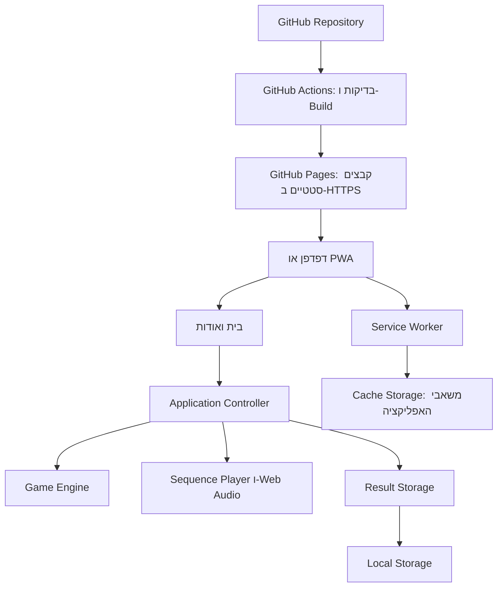

# ARCHITECTURE - משחק סיימון

תאריך המחקר: 18.10.2026. מקור הדרישות: [PRD.md](./PRD.md).

המערכת היא SPA סטטית למובייל, עם שני מסכים, מנגנון משחק מקומי ויכולת PWA ו-Offline. כל עיבוד המשחק נעשה בדפדפן. מסמך זה מתכנן את המימוש; הוא אינו מעיד שהאפליקציה נבנתה או נפרסה.

## 1. Technology Stack שנבחר

| רכיב | טכנולוגיה | תפקיד |
| --- | --- | --- |
| Frontend | TypeScript עם HTML ו-DOM APIs, ללא UI Framework | שני המסכים, אירועי המשתמש וניהול מצב המשחק |
| עיצוב | CSS רגיל, CSS Grid ו-Custom Properties | לוח המשחק, התאמת מובייל, RTL ומצבי הארה |
| סביבת פיתוח ו-Build | Vite 8, תבנית `vanilla-ts` | שרת פיתוח, אריזת הקוד והפקת קבצים סטטיים |
| כלי הרצה לפיתוח ו-CI | Node.js 24 LTS ו-npm | התקנת תלויות, בדיקות ו-Build בלבד; אין שרת Node.js ב-Production |
| PWA ו-Offline | vite-plugin-pwa 2 עם Workbox 7, באסטרטגיית `generateSW` | יצירת Manifest, Service Worker ו-Precache |
| צלילים | Web Audio API | יצירת ארבעה צלילים באמצעות OscillatorNode ו-GainNode, ללא קובצי שמע חיצוניים |
| תוצאה אחרונה | Local Storage | שמירת רשומה מקומית יחידה |
| בדיקות לוגיקה | Vitest | בדיקת כללי המשחק, ניקוד, תזמון וביטול פעולות |
| בדיקות דפדפן | Playwright | בדיקת הזרימות, Offline ורענון בתצוגת מובייל |
| ניהול קוד ו-CI/CD | GitHub ו-GitHub Actions | ניהול Git Repository ובדיקות ופריסה אוטומטיות |
| Hosting | GitHub Pages על HTTPS | הגשת תוצר ה-Build הסטטי |

אין Backend, Database, Authentication, שירות AI, API עסקי או שירות אחסון קבצים. האייקונים והקבצים הסטטיים נכללים באותו Build.

### 1.1 נימוקים מרכזיים והחלופות שנבחנו

- **Frontend:** נבחנו Vanilla TypeScript, React ו-Vue. ההחלטה היא Vanilla TypeScript: ארבעה כפתורי משחק ושני מסכים אינם מצדיקים שכבת UI נוספת. טיפוסים מפורשים ומנגנון מצב קטן מספקים בסיס ברור לתחזוקה ולפיתוח באמצעות AI. React ו-Vue מתאימים לממשקים גדולים יותר, אך אינם נדרשים להיקף הזה. זו מסקנת התאמה למוצר, ולא טענה ליתרון כללי בביצועים. מקורות: [TypeScript](https://www.typescriptlang.org/docs/handbook/intro.html), [React](https://react.dev/learn/build-a-react-app-from-scratch), [Vue](https://vuejs.org/guide/introduction.html).
- **Build:** נבחנו Vite ו-Parcel. Vite נבחר בזכות תבנית TypeScript ללא Framework, שילוב עם כלי הבדיקה ותוסף ה-PWA, ותהליך מתועד ל-GitHub Pages. CSS רגיל מספיק ללוח קבוע ואין צורך בספריית עיצוב. מקורות: [Vite](https://vite.dev/guide/), [Parcel](https://parceljs.org/).
- **PWA:** נבחנו יצירת Service Worker באמצעות Workbox ותוסף Vite, מול כתיבה ידנית. נבחר `generateSW` משום שכל המידע סטטי ואין צורך בלוגיקת רשת מותאמת. יצירת רשימת המשאבים והגרסאות אוטומטית מצמצמת טעויות Cache. מקורות: [Vite PWA](https://vite-pwa-org.netlify.app/guide/), [Workbox build](https://developer.chrome.com/docs/workbox/modules/workbox-build), [Service Workers](https://developer.mozilla.org/en-US/docs/Web/API/Service_Worker_API/Using_Service_Workers).
- **צליל:** נבחנו Web Audio API, קובצי שמע עם HTMLAudioElement ו-Howler.js. נבחר Web Audio API: ארבעה צלילים פשוטים ניתנים ליצירה מקומית ללא הורדות או תלות נוספת. Howler.js מתאים לצרכים רחבים יותר של ניהול שמע. מקורות: [Web Audio](https://developer.mozilla.org/en-US/docs/Web/API/Web_Audio_API/Best_practices), [HTMLAudioElement](https://developer.mozilla.org/en-US/docs/Web/API/HTMLAudioElement), [Howler.js](https://howlerjs.com/).
- **אחסון:** נבדקו Local Storage ו-IndexedDB. Local Storage מוכתב ב-PRD ומתאים לרשומה זעירה אחת; IndexedDB מוסיף מורכבות ללא צורך בנתונים מובנים רבים או בחיפושים. מקורות: [Local Storage](https://developer.mozilla.org/en-US/docs/Web/API/Window/localStorage), [IndexedDB](https://developer.mozilla.org/en-US/docs/Web/API/IndexedDB_API).
- **בדיקות:** נבחנו Vitest מול Jest, ו-Playwright מול Cypress. Vitest משתלב בסביבת Vite; Playwright מספק בדיקות Chromium ו-WebKit ו-Emulation למובייל. שני הכלים משמשים לפיתוח בלבד. מקורות: [Vitest](https://vitest.dev/guide/), [Jest](https://jestjs.io/docs/getting-started), [Playwright](https://playwright.dev/docs/intro), [Cypress](https://docs.cypress.io/app/get-started/why-cypress).
- **Hosting:** נבחנו GitHub Pages ו-Cloudflare Pages. שניהם תומכים בפריסה מתוך GitHub. GitHub Pages נבחר בהתאם להעדפת הפרויקט וכדי לרכז קוד ופריסה אצל ספק אחד. Cloudflare מציע חלופה עם Git integration ותוכנית חינמית הכוללת עד 500 Builds בחודש, אך אינו נדרש כאן. מקורות: [GitHub Pages](https://docs.github.com/en/pages/getting-started-with-github-pages/what-is-github-pages), [Cloudflare Git integration](https://developers.cloudflare.com/pages/configuration/git-integration/), [Cloudflare limits](https://developers.cloudflare.com/pages/platform/limits/).

הבחירה מסתמכת על תקני Web ותיעוד רשמי עם דוגמאות, ולא על מדד פופולריות לא מאומת. היעדר Framework אינו מחייב כתיבת Framework עצמאי: מבנה המערכת מוגבל ל-Modules המפורטים בהמשך.

### 1.2 תאימות וגרסאות

Node.js 24 הוא ענף LTS במועד המחקר. Vite תומך ב-TypeScript ללא Framework. תוסף PWA בגרסה 2 מצהיר על תמיכה ב-Vite 8 וב-Workbox 7.4.1 ומעלה בענף 7; דרישות Vitest המתועדות הן Vite 6.4 ומעלה ו-Node.js 22.12 ומעלה. שילוב זה תואם ברמת דרישות החבילות. מקורות: [Node.js releases](https://nodejs.org/en/about/previous-releases), [תלויות תוסף PWA בגרסה 2.0.0](https://raw.githubusercontent.com/vite-pwa/vite-plugin-pwa/v2.0.0/package.json), [Vitest requirements](https://vitest.dev/guide/).

יש לנעול גרסאות מדויקות של החבילות ב-`package-lock.json`, להשתמש ב-`npm ci` ב-CI ולהשתמש באותה גרסת Node.js בפיתוח וב-CI. גרסאות Patch ייקבעו בעת הקמת הפרויקט מתוך מהדורות יציבות ותואמות; אין להסתמך על `latest` בכל Build. בדיקת TypeScript עצמאית, `tsc --noEmit`, נדרשת בנוסף ל-Build. התאימות המחקרית אינה מחליפה התקנה ו-Build בפועל בעת המימוש.

### 1.3 עלויות ומגבלות

- **הנחת פריסה:** מאגר GitHub ציבורי ומשחק ללא מסחר או שירות SaaS בתשלום, בהתאם להיקף ה-PRD. GitHub Pages זמין ללא תשלום במאגרים ציבוריים ב-GitHub Free. מאגר פרטי דורש תוכנית GitHub תומכת בתשלום; המסמך אינו יוצר מאגר ואינו משנה את חשיפת הקוד. [זמינות Pages](https://docs.github.com/en/pages/getting-started-with-github-pages/what-is-github-pages).
- יעד עלות האירוח הוא **0 דולר לחודש** תחת ההנחה הזו, בשימוש בכתובת `github.io`, ב-Standard runners ובמכסות האחסון. אין תשלום על שרת, Database, קריאות API או שירותי AI. זמן הפיתוח אינו מתומחר במסמך. אין צורך ברכישת Domain. [חיוב GitHub Actions](https://docs.github.com/en/billing/concepts/product-billing/github-actions).
- מגבלות Pages כוללות אתר עד 1 GB, תעבורה של 100 GB בחודש כ-Soft limit וזמן פריסה עד 10 דקות. מגבלת 10 Builds לשעה אינה חלה על Custom GitHub Actions workflow. Pages אינו מיועד להפעלת עסק מקוון או SaaS מסחרי; הרחבה כזו תחייב בחינה מחדש. [מגבלות Pages](https://docs.github.com/en/pages/getting-started-with-github-pages/github-pages-limits).
- העיבוד נעשה בכל מכשיר בנפרד, ולכן גידול במספר השחקנים מגדיל בעיקר הורדות של קבצים סטטיים. לא ניתן להבטיח היקף משתמשים מסוים ללא נתוני שימוש ומדידה.
- Local Storage ו-Cache אינם גיבוי קבוע: ניקוי נתוני אתר, מצב פרטי או מדיניות הדפדפן עלולים להסיר אותם. התקנה אינה מבטיחה אחסון נצחי. אין סנכרון מובטח בין הדפדפן ל-PWA מותקן.

## 2. מבנה המערכת



Cache Storage הוא מנגנון הדפדפן לשמירת קבצי האתר לצורך Offline; הוא אינו Database עסקי ואינו שומר משחקים. Node.js ו-GitHub Actions פועלים רק בתהליך הפיתוח והפריסה.

### 2.1 Modules ואחריות

| Module | אחריות וגבולות |
| --- | --- |
| Views | הצגת בית ואודות, מצב פעיל של צבעים, הודעות ותוצאה; העברת כוונות משתמש ל-Controller |
| Application Controller | מקור האמת למצב האפליקציה; תיאום מנוע, תצוגה, שמע, השהיה ושמירה |
| Game Engine | כללים טהורים: יצירת רצף, בדיקת לחיצה, מעבר שלב, ניקוד וסיום; ללא DOM, אחסון או Timers |
| Sequence Player | הצגת הרצף בתזמון קבוע, הפעלת משוב וביטול מיידי של פעולות ממתינות |
| Audio Adapter | AudioContext יחיד, מיפוי צבע לצליל, הפעלה ועצירה; כשל שמע אינו משנה כללי משחק |
| Result Storage | קריאה, Validation וכתיבה של תוצאה יחידה; בידוד שגיאות אחסון מהמשחק |
| PWA Registration | רישום Service Worker וניהול מחזור העדכון; ללא אחריות למצב המשחק |

אין Redux, ספריית State Machine או Router חיצוני. מנגנון המשחק ממומש כמעברי State מפורשים ב-TypeScript; Controller קטן מטפל ב-Side Effects.

### 2.2 מסכים וניווט

שני המסכים חיים באותו HTML ובאותה כתובת בסיס. מעבר לאודות מעדכן מצב תצוגה בזיכרון ללא טעינת עמוד, ולכן המשחק יכול להישמר בהשהיה. לחצן חזרה פנימי מחזיר לבית. אין נתיבים נפרדים או Deep links; כך אין צורך ב-URL rewrites שאינם זמינים כברירת מחדל ב-GitHub Pages. רענון בכל מצב פותח את הבית במצב המתנה, בהתאם ל-PRD.

המסמך מגדיר `lang="he"` ו-`dir="rtl"`. רכיבי המשחק יהיו כפתורי HTML עם שמות נגישים בעברית, מיקום קבוע ומשוב הארה; לא Canvas. התוכן המוסתר לא יקבל Focus. אין טעינת פונטים או רכיבי UI מ-CDN חיצוני.

## 3. Data Model וניהול מצב

### 3.1 מצב בזיכרון בלבד

| נתון | טיפוס ותפקיד |
| --- | --- |
| `screen` | `home` או `about` |
| `phase` | `idle`, `playback`, `input`, `paused`, `won`, `lost` |
| `sequence` | מערך של `blue`, `red`, `yellow`, `green`, באורך עד 10 |
| `inputIndex` | האינדקס הבא שהשחקן נדרש להזין |
| `completedStages` | מספר השלבים שהושלמו, בטווח 0 עד 10 |
| `runToken` | מזהה מחזור ביצוע לביטול Callbacks ישנים |
| `lastResult` | התוצאה האחרונה שנטענה או הסתיימה בשימוש הנוכחי, או `null` |

השלב הנוכחי נגזר מאורך הרצף. בזמן משחק פעיל הוא שווה ל-`completedStages + 1`. במצב ניצחון הניקוד הוא 10; בכישלון הניקוד אינו גדל. אין שמירת State פעיל ב-Local Storage, ב-Session Storage או ב-Cache.

### 3.2 רשומה מתמשכת

מפתח ייחודי: `simon:last-result:v1`. הערך הוא JSON:

```json
{"schemaVersion":1,"score":7}
```

הרשומה תקינה רק אם הגרסה היא 1 ו-`score` הוא מספר שלם בין 0 ל-10. אין צורך בתאריך, מזהה משתמש או שדה ניצחון: ניקוד 10 משמעו ניצחון וכל ניקוד אחר הוא הפסד.

כותבים פעם אחת במעבר ל-`won` או `lost`, ודורסים את התוצאה הקודמת. התחלה, השהיה, יציאה ורענון אינם כותבים תוצאה. כאשר שתי לשוניות מסיימות משחקים, הכתיבה המוצלחת האחרונה באותו Origin היא התוצאה הנשמרת; אין סנכרון של משחקים פעילים.

קריאה, JSON parsing וכתיבה עטופים בטיפול בשגיאות. מידע חסר או פגום נחשב להעדר תוצאה. בכשל כתיבה התוצאה נשארת זמינה בזיכרון ובמסך הסיום, ומוצגת הודעה בעברית שהשמירה נכשלה. אין להציג תוצאה ישנה כאילו היא תוצאת המשחק החדש. Local Storage משותף ל-Origin ולא מבודד לפי נתיב; המפתח הייחודי מונע התנגשויות מקריות עם פרויקטים אחרים באותו חשבון Pages. [התנהגות Local Storage](https://developer.mozilla.org/en-US/docs/Web/API/Window/localStorage).

## 4. מנגנון המשחק ו-Data Flow

### 4.1 מעברים

| אירוע ומצב | פעולה והמצב הבא |
| --- | --- |
| "התחל" מתוך `idle`, או "שחקו שוב" מתוך מצב סיום | ביטול פעולות קודמות, איפוס ניקוד, בחירת צבע אחד ומעבר ל-`playback` |
| סיום הצגת רצף | איפוס `inputIndex` ומעבר ל-`input` |
| לחיצה נכונה שאינה האחרונה ברצף | הגדלת `inputIndex`; נשארים ב-`input` |
| השלמת רצף כשאורכו קטן מ-10 | הגדלת הניקוד, הוספת צבע ומעבר ל-`playback` לאחר הפסקה קבועה |
| השלמת רצף באורך 10 | ניקוד 10, מעבר ל-`won` ושמירת תוצאה |
| לחיצה שגויה במצב `input` | מעבר מיידי ל-`lost` ושמירת מספר השלבים שכבר הושלמו |
| מעבר לאודות בזמן משחק | ביטול הצגה ושמע, שמירת הרצף והניקוד בזיכרון ומעבר ל-`paused` |
| חזרה לבית ממשחק מושהה | איפוס התשובה החלקית והצגת אותו רצף מתחילתו, ללא הגרלת צבע נוסף |
| קלט צבע בכל מצב שאינו `input` | התעלמות ללא שינוי בניקוד |

ההגרלה תשתמש ב-`Math.random()` לבחירה אחידה מתוך ארבעת הצבעים; חזרות מותרות. אין צורך באקראיות קריפטוגרפית. לצורכי בדיקה בלבד ניתן להזריק מקור אקראיות צפוי למנוע, ללא אפשרות כזו בממשק.

### 4.2 תזמון, מגע ומניעת מרוצים

קבועי התזמון `FLASH_MS`, `GAP_MS` ו-`ROUND_PAUSE_MS` מוגדרים במקום אחד. ערכיהם ייקבעו בעיצוב, כמצוין ב-PRD, ולא ישתנו לפי שלב. ההפסקה בין הארות נשמרת גם כשאותו צבע חוזר ברצף.

Sequence Player מחזיק את פעולות התזמון הפעילות. התחלה חדשה, השהיה או סיום מבטלים Timers ושמע ומעדכנים `runToken`; כל Callback בודק שהוא עדיין שייך למחזור הנוכחי. יש לוודא שגם המתנות אסינכרוניות משתחררות בעת ביטול. כך רצף ישן אינו יכול להדליק כפתור או לקדם שלב במשחק חדש.

יש להשתמש במסלול קלט אחד המבוסס על Pointer Events, לקבל Pointer פעיל יחיד ולמנוע טיפול כפול באותה מחווה גם כ-`click`. הפעלת כפתור באמצעות מקלדת או טכנולוגיה מסייעת עוברת לאותה פעולת משחק ללא כפילות. לחיצות עוקבות תקינות נבדקות מיד, גם אם משוב הצליל הקודם טרם הסתיים. טעות נועלת קלט לפני הפעלת אנימציה או כתיבה לאחסון.

### 4.3 צליל והשהיה בנייד

AudioContext נוצר או מחודש באמצעות `resume()` כחלק מאירוע המשתמש של "התחל" או "שחקו שוב". כל צבע ממופה לתדר שונה וקבוע; מעטפת Gain קצרה מונעת קפיצות שמע. התדרים המדויקים ועוצמת הקול הם פרמטרי מימוש קבועים, ללא מסך הגדרות. אין תזמון מוקדם של רצף שלם שלא ניתן לעצור.

בחזרה מאודות יש לנסות לחדש את השמע במסגרת לחיצת החזרה. במעבר לרקע מאזינים ל-Page Visibility ול-`pagehide`, מבטלים את הנגינה ומשהים. בחזרה לקדמת המסך מוצג השלב מחדש רק אם הבית גלוי; אם האודות גלוי המשחק נשאר מושהה. שחזור באמצעות BFCache לא ישחזר Timers ישנים; טעינה מלאה תמיד מאפסת משחק.

חידוש AudioContext ללא מחוות משתמש עלול להיחסם בדפדפן. במקרה כזה מיישמים את הנחת ה-PRD: ממשיכים בהצגה חזותית, מציגים הודעת כשל שמע בעברית ומנסים לחדש בפעולת המשתמש הבאה, ללא חסימת המשחק או הוספת מסך. יש לבדוק זאת בטלפונים אמיתיים. [מדיניות הפעלת Web Audio](https://developer.mozilla.org/en-US/docs/Web/API/Web_Audio_API/Best_practices).

## 5. PWA, Offline ועדכונים

### 5.1 Manifest ונתיבים

ה-Manifest יכלול שם עברי "סיימון", `lang: he`, `dir: rtl`, `display: standalone`, אייקונים של 192 ו-512 פיקסלים ואייקון מתאים ל-Apple Touch. `id`, `start_url` ו-`scope` יוגדרו מתוך נתיב הבסיס של הפרויקט, לדוגמה `/<repository>/`. גם Vite `base`, כתובת ה-Service Worker וכל הפניות למשאבים חייבים להשתמש באותו בסיס. לא תוגדר שליטה של Service Worker על כל חשבון `github.io`.

התקנה זמינה לפי תמיכת מערכת ההפעלה והדפדפן, באמצעות המנגנון שלהם. אין הנחה ש-Install prompt אוטומטי זמין בכל נייד, ואין צורך במסך התקנה נוסף. HTTPS נדרש ב-Production; localhost מתאים לפיתוח. [דרישות התקנת PWA](https://developer.mozilla.org/en-US/docs/Web/Progressive_web_apps/Guides/Making_PWAs_installable).

### 5.2 Precache

`generateSW` יפיק Precache לכל משאבי ההרצה: HTML, JavaScript, CSS, Manifest ואייקונים, כולל רכיבי Workbox הדרושים. כל המשאבים נבנים ונשמרים באותו אתר; אין תלות ב-CDN חיצוני. השמע נוצר בדפדפן ולכן אינו דורש קובצי שמע ב-Cache.

יכולת Offline נחשבת מוכנה רק לאחר התקנה מוצלחת של ה-Service Worker והשלמת ה-Precache. אין להסיק מוכנות מעצם רישום ה-Service Worker או מ-`navigator.onLine`. לאחר מכן טעינה מחדש ושני המסכים פועלים ללא רשת. כשל בהכנת Cache אינו חוסם משחק שכבר נטען, אך אינו מאפשר להבטיח פתיחה עתידית Offline. המקור המקוון נחוץ שוב אם הדפדפן מחק את ה-Cache. [מנגנון Workbox](https://developer.chrome.com/docs/workbox/modules/workbox-build).

### 5.3 מדיניות עדכון

נבחר מצב רישום `prompt` לצורך שליטה במחזור החיים, אך לא יתווסף Dialog עדכון למוצר. `skipWaiting` ו-`clientsClaim` לא יופעלו בכפייה, ולא תתבצע קריאה אוטומטית ל-`updateSW()` או Reload במהלך שימוש.

גרסה חדשה תותקן ברקע ותישאר במצב Waiting כל עוד קיימים Clients המשתמשים בגרסה הישנה. היא תופעל במחזור החיים הרגיל לאחר סגירתם. רענון של לשונית יחידה אינו מבטיח הפעלת הגרסה החדשה. המשחק הנוכחי, לרבות התוצאה והמעבר לאודות, לא ייקטע בשל עדכון. ניקוי Caches ישנים יוגבל ל-Precache של אפליקציה זו לאחר הפעלת הגרסה החדשה; Local Storage לא יימחק. [ניהול עדכון ב-Vite PWA](https://vite-pwa-org.netlify.app/guide/prompt-for-update.html).

בפיתוח רגיל Service Worker יהיה כבוי כדי למנוע שימוש בקוד ישן. בדיקות Offline יבוצעו מול Production Build המוגש מקומית או מול Pages.

## 6. ממשקים, אבטחה ופרטיות

אין HTTP API עסקי או תקשורת עם שירות חיצוני בזמן משחק. הממשקים הפנימיים הם קריאות TypeScript: ה-Views שולחים כוונות, המנוע מחזיר State, וה-Controller מפעיל הצגה, שמע ושמירה. קריאות הרשת היחידות הנדרשות הן הורדת קבצי האתר ובדיקת עדכונים.

אין חשבונות, Authentication או Authorization למשתמשי המשחק. הרשאות עריכת הקוד והפריסה מנוהלות ב-GitHub. אין סודות ב-Frontend ואין צורך ב-API keys. אין להוסיף Analytics או SDKs למעקב.

הניקוד נשאר במכשיר ואינו נשלח לשרת. הוא ניתן לשינוי באמצעות כלי הדפדפן, וזה מקובל למשחק מקומי ללא טבלת מובילים. יש לבצע Validation לפני הצגתו ולהציג הודעות באמצעות APIs בטוחים כגון `textContent`, ללא הכנסת HTML ממקור לא מהימן.

GitHub Pages מגיש את האתר ב-HTTPS, אך אינו מספק כאן שכבת אבטחה מותאמת לנתונים רגישים. אין להשתמש באותו Origin למידע רגיש. ספק האירוח מתעד כתובות IP לצורכי אבטחה; לכן אין לטעון שהספק אינו אוסף מידע כלל. [איסוף מידע ב-GitHub Pages](https://docs.github.com/en/pages/getting-started-with-github-pages/what-is-github-pages).

## 7. GitHub, Configuration ו-Deployment

### 7.1 ניהול קוד וסביבות

קוד המוצר ינוהל ב-Git Repository ייעודי ב-GitHub, בנפרד ממסמכי מוצר אחר. ה-Repository יכלול קוד, נכסים סטטיים, שני מסמכי האפיון, הגדרות Build, בדיקות ו-Lockfile. לא יישמרו בו `node_modules` או קובצי משתמש. ברירת המחדל המתוכננת היא ענף `main` ל-Production וענפי עבודה לשינויים.

Development פועל באמצעות Vite מקומי, ו-Production על GitHub Pages. אין סביבות Database ואין Migrations. הנתונים המקומיים של localhost ושל האתר החי מופרדים לפי Origin. ההגדרות הלא סודיות הן נתיב הבסיס, שם המוצר, ארבעת הצלילים וקבועי התזמון. אין צורך ב-Environment variables עבור סודות.

### 7.2 תהליך CI/CD

1. Pull Request מפעיל התקנה באמצעות `npm ci`, בדיקת TypeScript, בדיקות Vitest, Build ובדיקות Playwright מול התוצר. הוא אינו מפרסם לאתר החי.
2. Push ל-`main` מפעיל את אותן בדיקות. כשל באחת מהן מונע פריסה.
3. Vite מפיק `dist/` הכולל את ה-PWA. ב-Settings של GitHub Pages מוגדר Source מסוג GitHub Actions.
4. ה-Workflow משתמש ב-Actions הרשמיים `configure-pages`, `upload-pages-artifact` ו-`deploy-pages` לפרסום אותו Artifact שנבדק, תחת Environment בשם `github-pages`.
5. הרשאות קריאה לקוד ניתנות ל-Build; רק Job הפריסה מקבל `pages: write` ו-`id-token: write`. אין צורך ב-Personal Access Token. Actions יינעלו ל-Commit SHA מאומת.
6. פריסות Production רצות בסדרת Concurrency אחת כדי למנוע גרסאות חופפות. אתר קיים לא מוחלף כאשר Build או בדיקות נכשלים.

הגדרת Pages וחיבור ה-Repository נדרשים פעם אחת; לאחר מכן שינוי ב-`main` מפעיל פריסה אוטומטית. זהו תכנון של מנגנון הפריסה ולא הוראה לפרסם כעת. [פריסת Vite ל-GitHub Pages](https://vite.dev/guide/static-deploy.html).

Rollback נעשה באמצעות Revert של שינוי בקוד ופריסה מחדש באותו Workflow. אצל משתמשים שכבר מחזיקים גרסה ב-Cache, ההחלפה כפופה למחזור עדכון ה-Service Worker ואינה מיידית. שינוי Domain או נתיב בסיס דורש עדכון Manifest ו-Scope ועלול לפגוע בהמשכיות ההתקנה או האחסון; לכן הכתובת תיקבע לפני ההפצה.

## 8. אימות טכני מול דרישות ה-PRD

| תחום | אימות נדרש |
| --- | --- |
| כללי משחק | רצף שמתחיל בצבע אחד ומתארך בצבע אחד; חזרות מותרות; אין שלב 11; טעות ראשונה מסיימת |
| ניקוד | הפסד בשלב 1 נותן 0; הפסד בשלב 10 נותן 9; ניצחון נותן 10; תוצאה נמוכה מחליפה קודמת |
| קלט ותזמון | התעלמות מקלט בזמן Playback; אין כפילות Touch ו-click; Callbacks מבוטלים אינם משנים State |
| ניווט והשהיה | אודות ורקע משמרים שלב וניקוד; בחזרה הרצף מוצג מחדש ללא הוספת צבע וללא תשובה חלקית |
| רענון ואחסון | משחק מתאפס; תוצאה נשמרת; מידע פגום או Storage חסום אינם מפילים את המשחק |
| Offline | טעינה מקוונת, השלמת Precache, מעבר ל-Offline ואז Reload, משחק מלא ומעבר בין המסכים |
| עדכונים | גרסה חדשה אינה מרעננת משחק פעיל; אחרי סגירת Clients מופעלת גרסה חדשה עם תוצאה שמורה |
| מובייל | RTL, גודל מגע, שמע, חזרה מרקע והתקנה ב-iPhone וב-Android אמיתיים |
| פריסה | כל הנכסים, Manifest ו-Service Worker נטענים תחת נתיב Repository ולא רק בשורש localhost |

Vitest בודק את המנוע עם אקראיות ותזמון נשלטים. Playwright בודק זרימות ב-Chromium וב-WebKit ובגדלי מסך ניידים. בדיקת Service Worker ו-Offline תכלול לפחות Chromium עם Service Workers מופעלים; אין להשתמש ב-Request mocking שמסתיר את פעולת ה-Cache. Emulation אינו מחליף בדיקה של התקנה, שמע ומחזור החיים בטלפונים אמיתיים. [Playwright Emulation](https://playwright.dev/docs/emulation).

הנחות מקרי הקצה המסומנות ב-PRD נשארות הנחות גם כאן: כשל שמע או אחסון, נתון פגום, מעבר לרקע ומגע מקביל. הארכיטקטורה מספקת עבורן מימוש מעשי בלי להוסיף מסכים, מצבי משחק או דרישות עסקיות.

## החלטות מרכזיות (ADRs)

### ADR-1: גופן Heebo מקומי באמצעות `@fontsource/heebo`
**הקשר:** DESIGN מגדיר את Heebo, וה-ARCHITECTURE אוסר טעינת גופנים מ-CDN חיצוני. ב-Milestone 4 כל המשאבים צריכים להיכנס ל-Precache.
**החלטה:** החבילה `@fontsource/heebo` מותקנת כתלות, ומיובאים ממנה המשקלים 400, 700 ו-800 בלבד. קובצי הגופן נארזים ב-Build ומוגשים מאותו אתר. Arial, sans-serif משמש כ-Fallback.
**השלכות:** אין בקשות רשת חיצוניות לגופן, וה-Precache יכלול אותו בהמשך. משקל נוסף ידרוש ייבוא נוסף ב-`src/main.ts`.

### ADR-2: נתיב בסיס `/simon/` כבר מתחילת הפיתוח
**הקשר:** האתר יוגש ב-GitHub Pages תחת נתיב ה-Repository. בעיות בנתיבים מתגלות לעיתים רק בפריסה.
**החלטה:** ב-`vite.config.ts` מוגדר `base: '/simon/'`. גם שרת הפיתוח וגם הבדיקות עובדים בכתובת `/simon/`.
**השלכות:** האתר המקומי נפתח בכתובת `http://localhost:5173/simon/`. שינוי שם ה-Repository יחייב עדכון של `base`, ובהמשך גם של ה-Manifest וה-Scope.

### ADR-3: החלפת מסכים באמצעות `hidden` והעברת Focus לכותרת
**הקשר:** שני המסכים חיים באותו עמוד. אסור שתוכן מוסתר יקבל Focus, והמעבר צריך להיות ברור למשתמשי מקלדת וקורא מסך.
**החלטה:** שני המסכים הם `<section>` באותו HTML. מצב המסך נשמר בזיכרון (`src/navigation.ts`), והמסך הלא פעיל מקבל את המאפיין `hidden`. אחרי כל מעבר ה-Focus עובר ל-`h1` של המסך החדש, והדף נגלל לראשו. ללא URL hash, ללא History API וללא שמירה, ולכן רענון תמיד פותח את הבית.
**השלכות:** כפתור "חזור" של הדפדפן אינו מנווט בין המסכים. ב-Milestone 2–3 ה-Controller ישתמש באותה פונקציית ניווט כדי להשהות ולחדש משחק.

### ADR-4: לוח המשחק ממוקם בתוך מעטפת ריבועית קבועה
**הקשר:** ב-WebKit (Safari), תוכן המקטעים הגדיל את גובה הלוח, והלוח יצא לא עגול. בנוסף, מיקומי הצבעים לא אמורים להתהפך בגלל RTL.
**החלטה:** המעטפת העגולה מוגדרת ב-`aspect-ratio: 1`. הגריד של ארבעת המקטעים ממוקם בתוכה ב-`position: absolute`, עם `direction: ltr` ו-`grid-template-areas` מפורש. כל מקטע מקבל רדיוס 100% בפינה החיצונית בלבד.
**השלכות:** הלוח נשאר עגול ביחס 1:1 בכל רוחב ובכל מנוע דפדפן, והמיקומים קבועים. בדיקת Playwright מאמתת את היחס ואת המיקומים.

### ADR-5: קבועי תזמון קבועים לכל השלבים
**הקשר:** PRD ו-DESIGN לא קבעו משכי הארה והפסקה, ודורשים קצב קבוע וברור, בלי האצה.
**החלטה:** ב-`src/game/timing.ts`: `FLASH_MS = 600`, `GAP_MS = 250`, `ROUND_PAUSE_MS = 800`, `PRESS_FLASH_MS = 250`. ההפסקה החשוכה נשמרת גם כשאותו צבע חוזר.
**השלכות:** שינוי קצב נעשה במקום אחד. הערכים הם החלטת מימוש לבדיקת המשתמש, ולא עיצוב מאושר.

### ADR-6: מסלול קלט יחיד ו-`aria-disabled`
**הקשר:** יש למנוע רישום כפול של מגע ו-`click`, לקבל קלט אחד בכל פעם ולתמוך במקלדת.
**החלטה:** קלט מגע/עכבר מגיע רק מ-`pointerdown`, עם Pointer פעיל יחיד עד `pointerup`/`pointercancel`. `click` מטופל רק כש-`detail === 0` (מקלדת/טכנולוגיה מסייעת). המקטעים מסומנים `aria-disabled` מחוץ לתור השחקן (במקום `disabled`), כדי שה-Focus לא ייעלם בין שלבים; המנוע מתעלם מקלט מחוץ ל-`input` בכל מקרה.
**השלכות:** לחיצה אחת = פעולה אחת. משתמשי מקלדת נשארים על המקטע לאורך המשחק.

### ADR-7: צלילים ב-Web Audio
**הקשר:** נדרשים ארבעה צלילים מובחנים ללא קבצים, וטיפול בכשל שמע.
**החלטה:** AudioContext יחיד שמופעל ב-`unlock()` בתוך הלחיצה על ״התחל״, ״שחקו שוב״ ו״חזרה למשחק״. גל `triangle` עם מעטפת Gain קצרה; תדרים: כחול 209Hz, אדום 310Hz, צהוב 252Hz, ירוק 415Hz. אם אין Web Audio או שההפעלה נכשלת — המשחק ממשיך באורות ומוצגת הודעה.
**השלכות:** אין קובצי שמע ל-Precache. בדיקת השמע בטלפונים אמיתיים נדרשת ב-Milestone 5.

### ADR-8: הודעות המצב והסיום בתוך מסך הבית
**הקשר:** ה-Mockups מציגים רק את מצב ההמתנה; הפריסה והנוסח של מצבי המשחק והסיום לא הוגדרו.
**החלטה:** בין הלוח לכפתור מוצג אזור אחד: בזמן משחק ״שלב N מתוך 10 · צפו ברצף״ / ״תורכם״ (״התחל״ מוסתר); בסיום ״טעות! המשחק נגמר״ או ״כל הכבוד! ניצחתם״, הניקוד ״X מתוך 10״ בגודל בולט וכפתור משני ״שחקו שוב״. במצב המתנה האזור מוסתר, כך שהמסך זהה ל-Mockup. בזמן הצגת הרצף המקטעים שאינם מוארים מעומעמים מעט. הודעות כשל שמירה ושמע מוצגות מתחת. כל הנוסחים מרוכזים ב-`TEXT` שב-`src/view.ts`.
**השלכות:** אין מסך שלישי. שינוי נוסח נעשה במקום אחד. הפריסה היא החלטת מימוש לבדיקת המשתמש.

### ADR-9: בדיקות דפדפן עם שעון מבוקר וקריאת הרצף מהדף
**הקשר:** משחק מלא נמשך כדקה בזמן אמת, והבדיקה צריכה לדעת את הרצף בלי ״דלת אחורית״ בקוד המוצר.
**החלטה:** בדיקות Playwright משתמשות ב-`page.clock` להרצת הזמן, ורושמות מתוך הדף אילו מקטעים הוארו בזמן ההצגה. בדיקות Controller ב-Vitest משתמשות ב-View מדומה ובשעון מדומה, ולכן לא נוספה סביבת DOM (happy-dom) שתוכננה במקור.
**השלכות:** אין Test hooks במוצר ואין תלות חדשה. הבדיקות מהירות ויציבות.

### ADR-10: מחזור חיי הדף דרך מודול `lifecycle` אחד
**הקשר:** יש להשהות את המשחק במעבר לרקע, בנעילה וביציאה מהדף, ולחזור אליו בבטחה, כולל שחזור מ-BFCache.
**החלטה:** `src/lifecycle.ts` מתרגם `visibilitychange`, `pagehide` ו-`pageshow` (רק עם `persisted`) לשתי פעולות: `onHide` ו-`onShow`. ה-Controller זוכר איזה מסך גלוי: `onHide` עוצר תמיד הארה, שמע ו-Timers ומשהה משחק פעיל; `onShow` מציג מחדש את השלב רק כשהבית גלוי. שתי הפעולות בטוחות לקריאה חוזרת. אין מאזיני `unload`/`beforeunload`.
**השלכות:** אירועים כפולים או מעברים מהירים אינם מכפילים רצפים. בחזרה, השלב מתחיל מחדש אוטומטית אחרי ההפסקה הקבועה, בלי כפתור ״המשך״.

### ADR-11: זיהוי שמע חסום וניסיון חוזר בלחיצה הבאה; בדיקות רקע מדומות
**הקשר:** אחרי חזרה מהרקע הדפדפן עשוי להשאיר את ה-AudioContext מושהה ולחסום חידוש שלא במסגרת לחיצה. הבטחת `resume()` עשויה לא להסתיים כלל. בנוסף, Playwright (גם בחלון גלוי) והדפדפנים המובנים בסביבת הפיתוח אינם משנים את `visibilityState` במעבר לשונית או במזעור.
**החלטה:** `play()` מזהה Context שאינו `running`, מציג את הודעת השמע הקיימת ומנסה בשקט `resume()`; האזנה ל-`statechange` מסתירה את ההודעה כשהשמע חוזר. כל לחיצה על צבע קוראת ל-`unlock()` כדי לחדש שמע במסגרת מחוות משתמש. בבדיקות Playwright מדמים מתוך הדף את `visibilityState`, את `pagehide`/`pageshow(persisted)` ואת AudioContext שנחסם ברקע.
**השלכות:** אין נוסח או פקד חדש. מעבר רקע אמיתי נבדק ידנית בידי המשתמש בדפדפן רגיל; נעילת מכשיר ושמע בטלפונים אמיתיים נבדקים ב-Milestone 5.

### ADR-12: הגדרת PWA ב-`vite-plugin-pwa` (`generateSW`, `prompt`) ורישום ידני
**הקשר:** נדרשים Manifest, Precache מלא ועדכון שאינו קוטע משחק, ללא Dialog וללא Reload כפוי.
**החלטה:** `vite.config.ts` מגדיר `VitePWA` עם `registerType: 'prompt'`, `injectRegister: false`, `skipWaiting: false`, `clientsClaim: false`, `cleanupOutdatedCaches: true` ו-`devOptions.enabled: false`. ה-Manifest: `id`/`start_url`/`scope` = `/simon/`, שם ״סיימון״, `lang: he`, `dir: rtl`, `display: standalone`, רקע ונושא `#070B26`. ה-Precache כולל HTML, JS, CSS, SVG, PNG וקובצי `woff2` בלבד של הגופן (ללא העותקים ב-`woff`). הרישום נעשה ב-`src/pwa.ts` באמצעות `registerSW({ immediate: true })`, בלי `onNeedRefresh` ובלי קריאה לפונקציית העדכון; כשל רישום נרשם ב-Console בלבד.
**השלכות:** גרסה חדשה נשארת Waiting עד שכל הלשוניות הישנות נסגרות, ואין שום הודעת Offline או עדכון בממשק. ב-`npm run dev` אין Service Worker; PWA נבדק רק מול Build. שינוי נתיב הבסיס מחייב עדכון `BASE` ב-`vite.config.ts` בלבד.

### ADR-13: אייקון ממקור SVG אחד, קובצי PNG נשמרים ב-Repository
**הקשר:** DESIGN והתמונות אינם מגדירים אייקון אפליקציה, וה-Manifest דורש 192 ו-512 פיקסלים ו-Apple Touch Icon.
**החלטה:** אייקון מינימלי שנגזר מהלוח: ארבעה רבעים בצבעי המשחק ובמיקומיהם הקבועים, עם מרווח Graphite, על רקע שקוף, ללא טקסט (`public/icons/icon.svg`; לפי בקשת המשתמש). שני אייקונים חייבים רקע אטום ולכן נשארו על רקע Midnight Navy: גרסת Maskable (Android חותך אותה לצורה מלאה; הלוח מוקטן לאזור הבטוח) ו-Apple Touch Icon (iOS ממלא שקיפות בשחור). קובצי ה-PNG (192, 512, Maskable 512, Apple 180) נוצרו פעם אחת מה-SVG באמצעות Playwright ונשמרו ב-`public/icons/`. Favicon הוא `public/favicon.svg`. זו החלטת מימוש לבדיקת המשתמש, לא עיצוב מאושר.
**השלכות:** אין שלב יצירת אייקונים ב-Build ואין תלות נוספת. שינוי אייקון מחייב יצירה מחדש של קובצי ה-PNG.

### ADR-14: בדיקות PWA מול Build אמיתי עם שרת סטטי מתחלף
**הקשר:** יש לבדוק Offline, עדכון בין שתי גרסאות וכשל Cache בלי Mock שמסתיר את פעולת ה-Cache.
**החלטה:** פרויקט Playwright נפרד, `chromium-pwa`, מריץ את `tests/e2e/pwa/` עם Service Workers פעילים ובלי `page.clock`. Offline מדומה ב-`context.setOffline`. לבדיקת העדכון נבנים שני Builds (`dist-a`, `dist-b`) עם `SIMON_BUILD_ID` שונה; המזהה מוזרק ב-`define` (`__BUILD_ID__`) ומסומן ב-`<html data-build>`, וכך ה-JS ו-`sw.js` שונים באמת. שרת Node זעיר (`static-server.ts`) מחליף תיקייה ויכול להחזיר 500 לקובץ אחד. מחיקת נתוני אתר נעשית ב-CDP. WebKit אינו מריץ את בדיקות ה-Service Worker.
**השלכות:** ה-CI הקיים מריץ את הבדיקות ללא שינוי. התנהגות iOS/Safari ב-PWA תיבדק במכשיר אמיתי ב-Milestone 5. `dist-*/` נוספו ל-`.gitignore`.

### ADR-15: Workflow אחד עם Job בדיקה ו-Job פריסה, מעל Build יחיד
**הקשר:** יש לפרסם בדיוק את התוצר שנבדק, לא לפרסם מ-Pull Request, ולמנוע פריסות חופפות.
**החלטה:** `.github/workflows/ci.yml` כולל Job `test` שבונה את `dist/` פעם אחת ומריץ עליו את Playwright (`SIMON_SKIP_BUILD=1` גורם ל-`playwright.config.ts` להגיש את `dist/` הקיים בלי לבנות מחדש). רק ב-Push ל-`main` ה-Job מעלה את אותו `dist/` באמצעות `configure-pages` ו-`upload-pages-artifact`. Job `deploy` תלוי ב-`test`, רץ רק ב-Push ל-`main`, מקבל לבדו `pages: write` ו-`id-token: write`, משתמש ב-Environment `github-pages` ורץ בסדרת Concurrency `pages` ללא ביטול. Concurrency של כל ה-Workflow מבטל ריצה קודמת רק ב-Pull Request. בכשל נשמרים `test-results/` (כולל Trace) כ-Artifact ל-7 ימים. כל ה-Actions נעולים ל-Commit SHA של הגרסה העדכנית.
**השלכות:** כשל בכל שלב מונע פריסה והאתר הקיים נשאר. הגדרת Pages ב-Settings (Source: GitHub Actions) נדרשת פעם אחת.

### ADR-16: מזהה הגרסה הוא ה-Commit
**הקשר:** לפי `vite.config.ts`, ללא `SIMON_BUILD_ID` המזהה הוא גרסת `package.json`, שאינה משתנה בין פריסות.
**החלטה:** ה-CI בונה עם `SIMON_BUILD_ID=${{ github.sha }}`. המזהה מופיע ב-`<html data-build>` ומשנה את ה-JS ואת `sw.js` בכל פריסה.
**השלכות:** אפשר לזהות איזו גרסה חיה ולבדוק עדכון בין שתי גרסאות אמיתיות. כל Push ל-`main`, גם שינוי מסמך בלבד, יוצר גרסת Service Worker חדשה שתופעל אחרי סגירת הלשוניות.

### ADR-17: בדיקות מול האתר החי בפרויקט Playwright נפרד
**הקשר:** ה-CI רץ לפני הפריסה ולכן אינו יכול לבדוק את האתר החי.
**החלטה:** `tests/e2e/live/` רץ רק כשמוגדר `SIMON_LIVE_URL` (`npm run test:live`, ברירת המחדל היא כתובת האתר), בפרויקט `live` ב-Chromium עם Service Workers ובלי `webServer`. בדיקת העדכון רצה רק עם `SIMON_LIVE_UPDATE=1`: היא מתחילה משחק וממתינה (עד 18 דקות) לפריסה הבאה. כל שאר הפרויקטים מתעלמים מ-`live/**`.
**השלכות:** הבדיקה ידנית ואינה חלק מהתנאי לפריסה. התנהגות Safari ו-PWA ב-iPhone נבדקת במכשיר אמיתי בלבד.

### ADR-18: הארכת זמן הבדיקה של משחק מלא
**הקשר:** ב-CI הבדיקה ״plays a full game to a win״ נכשלה ב-WebKit בכל ריצה מאז Milestone 2, בחריגה מ-30 שניות. בניסיון החוזר היא הגיעה לסוף המשחק לפני החריגה, ובמחשב מקומי היא נמשכת כ-9 שניות; זו איטיות של ה-Runner ולא תקיעה בממשק.
**החלטה:** `test.slow()` לבדיקה הזו בלבד (פי 3 מהזמן).
**השלכות:** אין שינוי בקוד האפליקציה. אם תופיע תקיעה אמיתית, ה-Trace שנשמר ב-CI יאפשר לאבחן אותה.
