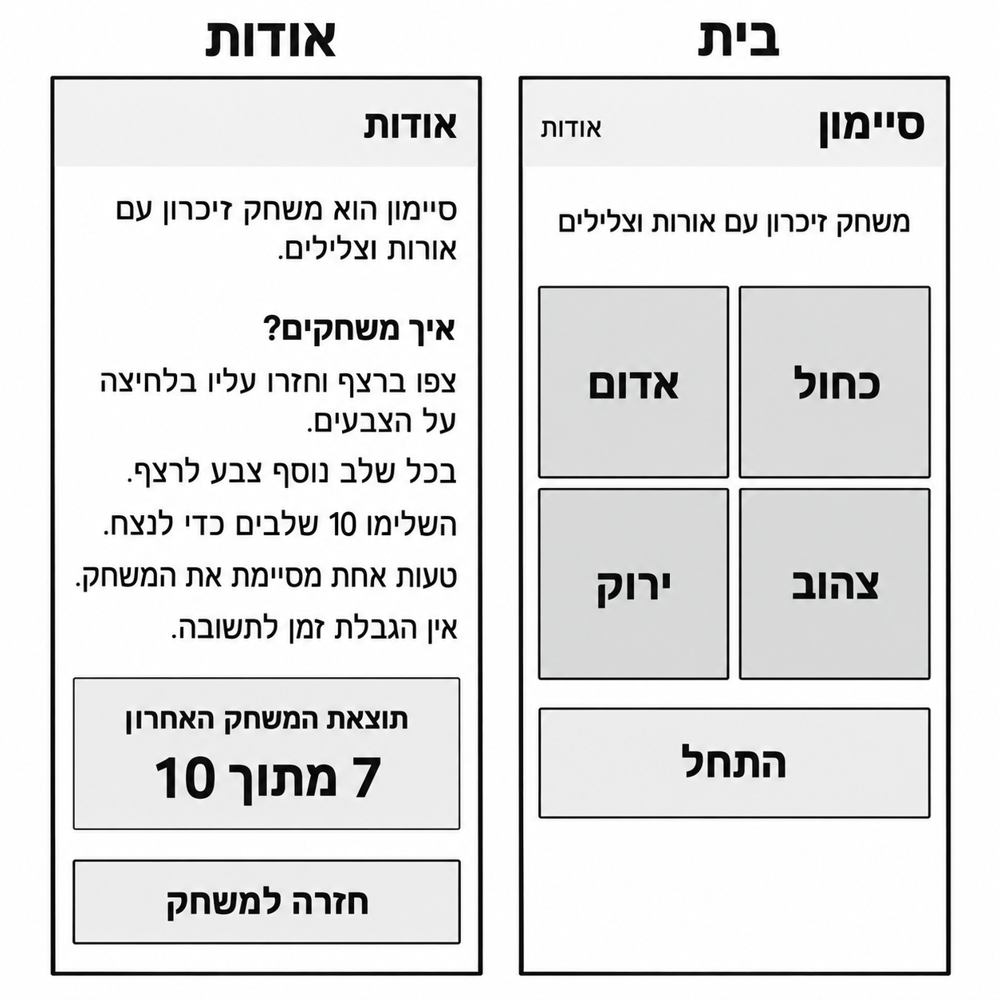
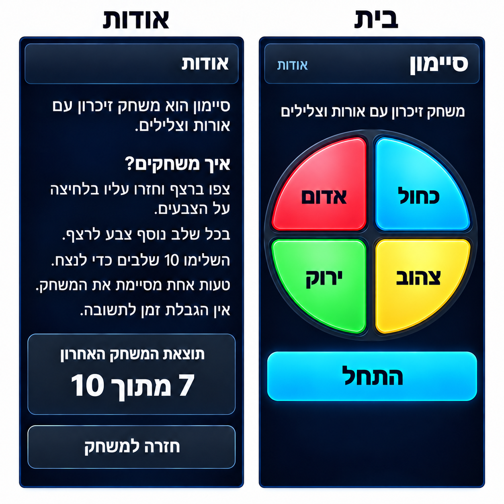
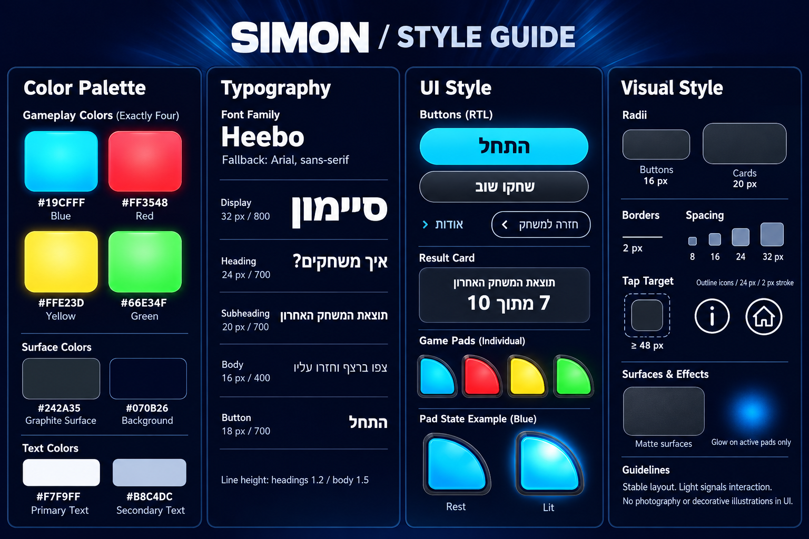

# DESIGN - משחק סיימון

מסמך זה מתאר את מימוש העיצוב על בסיס [PRD.md](./PRD.md) ושלוש התמונות המצורפות. ה-PRD קובע את ההתנהגות; ה-Wireframes קובעים את סדר התוכן; ה-Style Guide קובע את שפת העיצוב; ה-Mockups המתוקנים קובעים את המראה הסופי.

**תיקון עיצובי מחייב:** ארבעת אזורי המשחק יוצרים לוח עגול, עם קצוות חיצוניים קמורים, כפי שמופיע ב-Mockups המתוקנים. הריבועים ב-Wireframes מייצגים את מיקום האזורים בלבד ואינם הצורה למימוש.

## 1. Screens - מסכי האפליקציה

### תמונת המבנה

### 1.1 בית

**מטרת המסך:** התחלת משחק, אינטראקציה עם לוח הצבעים וצפייה בתוצאה בסיום.

**מבנה ותוכן, מלמעלה למטה:**

1. Header כהה עם פינות מעוגלות: כותרת ״סיימון״ בצד ימין וקישור ״אודות״ בצד שמאל.
2. שורת תיאור ממורכזת: ״משחק זיכרון עם אורות וצלילים״.
3. לוח משחק עגול ודומיננטי במרכז המסך. ארבעת אזורי הצבע מסודרים בשתי שורות ושתי עמודות ומופרדים ברווח כהה בצורת צלב. לכל אזור תווית בצבע כהה, במרכזו:

| מיקום קבוע | צבע ותווית |
| --- | --- |
| ימין למעלה | כחול |
| שמאל למעלה | אדום |
| ימין למטה | צהוב |
| שמאל למטה | ירוק |

4. מתחת ללוח, כפתור ראשי רחב עם התווית ״התחל״.
5. יתרת המסך נשארת פנויה, כפי שמוצג ב-Mockup; אין למלא אותה ברכיבים נוספים.

**פעולות וניווט:** ״התחל״ מפעיל את המשחק, אזורי הצבע משמשים להזנת התשובה, ו״אודות״ פותח את מסך האודות. התנהגות הקלט וההשהיה מוגדרת ב-PRD.

**מצבים שאינם מוצגים ב-Mockup:** התמונה מתארת את מצב ההמתנה. בזמן משחק נדרשת הבחנה בין הצגת הרצף לתור השחקן, ובסיום מוצגים בתוך מסך הבית הודעת סיום, ניקוד וכפתור ״שחקו שוב״, בהתאם ל-PRD. ה-Style Guide מספק סגנון לכפתור זה. הפריסה המדויקת של הודעות המצב והסיום והנוסח שלהן לא הוגדרו בתמונות; אין להתייחס אליהן כעיצוב חזותי סגור או ליצור עבורן מסך שלישי.

### 1.2 אודות

**מטרת המסך:** קריאת הסבר והוראות, צפייה בתוצאה האחרונה וחזרה למשחק.

**מבנה ותוכן, מלמעלה למטה:**

1. Header באותו סגנון כמו בבית, עם הכותרת ״אודות״ מיושרת לימין.
2. תיאור קצר, מיושר לימין: ״סיימון הוא משחק זיכרון עם אורות וצלילים.״
3. כותרת משנה מודגשת: ״איך משחקים?״
4. הוראות בפסקאות קצרות, ללא מספור או אייקונים:
   - ״צפו ברצף וחזרו עליו בלחיצה על הצבעים.״
   - ״בכל שלב נוסף צבע לרצף.״
   - ״השלימו 10 שלבים כדי לנצח.״
   - ״טעות אחת מסיימת את המשחק.״
   - ״אין הגבלת זמן לתשובה.״
5. כרטיס תוצאה כהה עם פינות מעוגלות וקו מתאר עדין. במרכזו הכותרת ״תוצאת המשחק האחרון״ ומתחתיה הניקוד בגודל בולט. ״7 מתוך 10״ שבתמונות הוא נתון לדוגמה; במימוש מוצגת התוצאה בפועל.
6. כפתור משני רחב: ״חזרה למשחק״, מתחת לכרטיס התוצאה.

**פעולות וניווט:** ״חזרה למשחק״ מחזיר לבית. כאשר המשחק מושהה, החזרה פועלת לפי ה-PRD. אין רכיב עריכה לתוצאה, קרדיט או פעולות נוספות.

מצב ללא תוצאה והודעות שגיאה מוגדרים כהנחות ב-PRD, אך אין להם עיצוב או נוסח סופי בתמונות. אין להציג את נתון הדוגמה כאשר לא קיימת תוצאה.

### 1.3 מבנה הניווט והצגת המסכים

הניווט כולל שני מסכים בלבד: מהבית לאודות באמצעות ״אודות״, ובחזרה באמצעות ״חזרה למשחק״. אין Bottom Navigation, תפריט נפתח או מסך סיום נפרד.

בלוחות ההמחשה הבית מופיע מימין והאודות משמאל. במוצר מוצג מסך אחד בכל פעם. שמות המסכים שמעל המסגרות, הרקע הלבן שסביבן והצגת שני המסכים זה לצד זה שייכים ללוח ההמחשה בלבד ואינם חלק מה-UI.

### המראה הסופי

## 2. Style Guide - השפה העיצובית

### 2.1 Color Palette

קודי ה-HEX הבאים מוגדרים ב-Style Guide ומשמשים כצבעי הבסיס. ההבהרות וההצללות ב-Mockups נגזרות מהם; אין במקורות ערכים מספריים לכל Gradient או Shadow.

| שימוש | צבע | HEX |
| --- | --- | --- |
| רקע המסכים | Midnight Navy | `#070B26` |
| משטחי כרטיסים ומסגרות הלוח | Graphite | `#242A35` |
| כותרות וטקסט ראשי על רקע כהה | Primary Text | `#F7F9FF` |
| טקסט משני | Secondary Text | `#B8C4DC` |
| אזור ״כחול״ והכפתור הראשי | Blue | `#19CFFF` |
| אזור ״אדום״ | Red | `#FF3548` |
| אזור ״צהוב״ | Yellow | `#FFE23D` |
| אזור ״ירוק״ | Green | `#66E34F` |

ארבעת הצבעים הרוויים ממקדים את תשומת הלב בלוח המשחק. הכותרות וההוראות בהירות על רקע כהה; תוויות הצבעים והכפתור הראשי כהות על רקע בהיר. אזור ״כחול״ משתמש בגוון הכחול-ציאן שב-Style Guide, תוך שמירת התווית ״כחול״.

### 2.2 Typography

משפחת הגופנים היא **Heebo**, עם Fallback מסוג **Arial, sans-serif**. הגדלים הם גדלי UI מומלצים ב-CSS pixels מה-Style Guide, ולא מדידה של הטקסט בתמונת הלוח המוגדלת.

| דרגה | גודל | משקל | שימוש לדוגמה |
| --- | --- | --- | --- |
| Display | 32 px | 800 | ״סיימון״ |
| Heading | 24 px | 700 | ״איך משחקים?״ |
| Subheading | 20 px | 700 | ״תוצאת המשחק האחרון״ |
| Body | 16 px | 400 | תיאור המשחק וההוראות |
| Button | 18 px | 700 | ״התחל״ ו״חזרה למשחק״ |

- Line height לכותרות: `1.2`; לטקסט רגיל: `1.5`.
- הטיפוגרפיה ישרה ונקייה, ללא הטיה דקורטיבית.
- הניקוד ותוויות הצבעים מוצגים ב-Mockups כטקסט גדול ומודגש. לא הוגדר להם גודל נפרד ב-Style Guide; יש לשמר את הבולטות וההתאמה לשטח הרכיב ללא ייחוס ערך מדויק למקור.
- יש לשמור על שבירת שורות טבעית בעברית ולא לדחוס טקסט כדי לחקות את מספר השורות בתמונה בכל רוחב מכשיר.

### 2.3 UI Style

#### לוח המשחק

הלוח מורכב מארבעה מקטעים דמויי רבע עיגול, המסודרים בתוך מעטפת Graphite עגולה. לכל מקטע שני קצוות פנימיים כמעט ישרים וקשת חיצונית רחבה, עם ריכוך בנקודות המפגש. אין לממש ארבעה אריחים מרובעים שרק פינותיהם מעוגלות מעט.

הצלב הכהה מפריד בין אזורי המגע. המסגרת, קו ההבהרה הפנימי וההצללה העדינה מעניקים תחושה של כפתורי משחק פיזיים. אין כפתור או תווית במרכז הלוח. מיקומי הצבעים נשארים כפי שמוגדר בטבלת המסך ואינם מתהפכים עקב RTL.

ה-Style Guide מציג שני מצבים:

- **Rest:** צבע ברור עם הצללה והבהרת משטח עדינות, ללא Halo פעיל.
- **Lit:** הבהרה משמעותית במרכז המקטע והילה בגוון שלו. הצורה, התווית והמיקום אינם משתנים.

ההילה הפעילה מיועדת למשוב המשחק. קווי ההבהרה הקבועים ב-Mockup הם חלק ממראה החומר ואינם סימון שכל המקטעים פעילים בו-זמנית. משכי ההארה וההפסקות לא נקבעו במקורות.

#### כפתורים וניווט

- **Primary:** ״התחל״ מוצג ככפתור רחב בגוון Blue, עם טקסט כהה ומודגש, פינות מעוגלות והבהרת שוליים עדינה.
- **Secondary:** ״חזרה למשחק״ משתמש במשטח Graphite, טקסט בהיר וקו מתאר בהיר-כחלחל. ״שחקו שוב״ משתמש בשפה המשנית המוצגת ב-Style Guide.
- **Text Navigation:** ״אודות״ מופיע כקישור טקסט בהיר-כחלחל בצד שמאל של ה-Header בבית.
- Radius לכפתורים: `16 px`, כפי שנקבע ב-Style Guide. אין לפרש את דוגמאות הכפתורים המוארכות כדרישה לצורת Capsule בכל רוחב.
- אזור המגע הוא לפחות `48 px`, לפי ה-Style Guide.

#### Header וכרטיס תוצאה

ה-Header הוא משטח כהה עם פינות מעוגלות, קו מתאר כחלחל עדין והבדל גוון מתון מהרקע. בשני המסכים נשמרים אותה שפה חזותית ויישור כותרת לימין.

כרטיס התוצאה משתמש במשטח Graphite, Radius של `20 px` וטקסט ממורכז. הניקוד בולט יותר מכותרת הכרטיס. קווי מתאר רגילים מבוססים על `2 px`; מסגרת הלוח כוללת שכבות חזותיות נוספות כפי שנראה ב-Mockup.

אין במוצר שדות קלט, טפסים או תפריטים, ולכן אין להוסיף להם רכיבים או סגנונות. דוגמאות אייקוני הבית והמידע ב-Style Guide מגדירות שפת Outline בגודל `24 px` ובעובי קו `2 px`, אך אינן הוראה להוסיף אייקונים שאינם מופיעים במסכים הסופיים.

### 2.4 Visual Style ו-Layout

האווירה היא משחק זיכרון אלקטרוני: רקע Navy עמוק, מעטפת כהה וארבעה צבעים בוהקים. המראה עשיר אך ממוקד בלוח המשחק, ללא תמונות, איורים דקורטיביים או קרני אור ברקע המסכים.

- **צורות:** מעטפת לוח עגולה, מקטעים קמורים וכרטיסים וכפתורים בעלי פינות מעוגלות.
- **עומק:** Gradients מתונים, קווי הבהרה וצללים רכים, בהתאם ל-Mockups. ערכי Blur, Opacity ו-Gradient stops לא הוגדרו מספרית במקורות.
- **Spacing:** סולם המרווחים הוא `8 / 16 / 24 / 32 px`. מרווחים קטנים מקבצים תוכן קשור, וגדולים מפרידים בין אזורי התוכן. מיפוי מדויק לכל מרווח אינו מוגדר בתמונות.
- **פריסה:** עמודה אחת בכל מסך, שוליים פנימיים עקביים וכפתורים רחבים. לוח המשחק נשאר ברוחב הזמין עם יחס `1:1`, ולא נמתח לאליפסה.
- **מובייל:** היחס הגבוה של המסגרות הוא המחשת Viewport של Smartphone, לא גובה CSS קבוע. הפריסה מתאימה לגובה ולרוחב הזמינים. אם התוכן חורג בגובה, יש לאפשר גלילה אנכית בלי לחתוך תוכן או להקטין את הטקסט כדי שייכנס. אין גלילה אופקית.
- **גבולות התמונה:** אין להעתיק למוצר את מסגרת לוח ההמחשה או את הצל החיצוני שמפריד בין מסך לרקע הלבן. העיצוב הפנימי של כל מסך הוא ההפניה למימוש.

### 2.5 שפה וכיווניות

כל טקסטי הממשק בעברית ובכיווניות RTL. תיאור המשחק וההוראות מיושרים לימין. הטקסט על הכפתורים, תוויות הצבעים והניקוד ממורכזים בהתאם ל-Mockups. מיקום קישור ״אודות״ בצד שמאל של ה-Header מכוון ואינו משתנה בעקבות יישור הטקסט.

יש להציג את הניקוד כמשפט עברי, לדוגמה ״7 מתוך 10״, תוך שמירת סדר המספרים התקין. כותרות באנגלית וקודי HEX שמופיעים בלוח ה-Style Guide הם תיעוד עיצובי בלבד ואינם תוכן בממשק.
